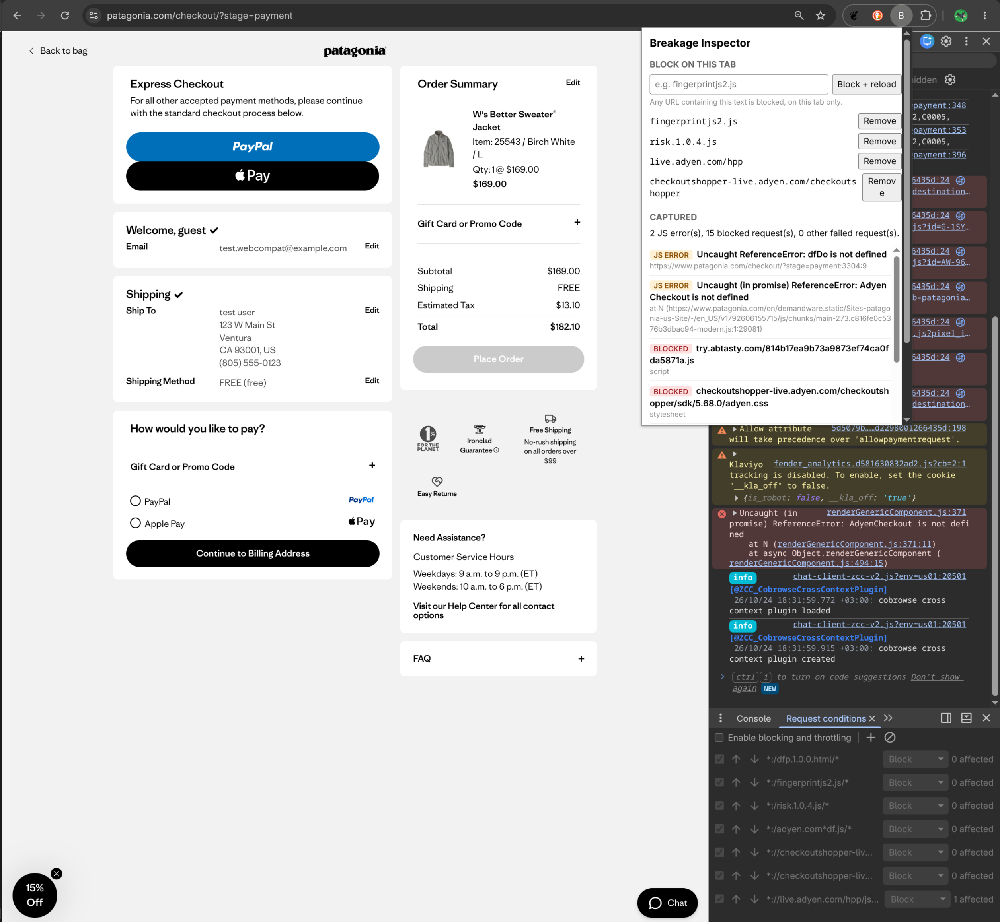

# Breakage Inspector

A small Chrome extension (Manifest V3) for debugging websites that break under
privacy protections. For the current tab it shows:

- **Uncaught JavaScript errors**, including rejected promises from `async` code
- **Blocked and failed requests**, for example `net::ERR_BLOCKED_BY_CLIENT`
  from a tracker blocker
- **One-click blocking**: type part of a URL, and the extension blocks it on
  this tab only and reloads the page

It turns the DevTools routine I used in my
[Patagonia checkout case study](https://github.com/nacikr/patagonia-adyen-webcompat)
into a few clicks: block a script, reload, see what broke and why.



## What it found

Re-running the Patagonia experiments with the extension:

| Rule on the tab | JS errors | Payment methods |
| --- | --- | --- |
| `checkoutshopper-live.adyen.com/checkoutshopper` | `Uncaught (in promise) ReferenceError: AdyenCheckout is not defined` | 2 of 6 |
| `fingerprintjs2.js`, `risk.1.0.4.js`, `live.adyen.com/hpp` | `Uncaught ReferenceError: dfDo is not defined` | 6 of 6 |
| none | none | 6 of 6 |

The second row is something my manual check had missed: I had filtered the
DevTools Console by `adyen`, and the `dfDo` error does not contain that word.
The extension collects every uncaught error without a filter.

## Install

1. Download or clone this repository.
2. Open `chrome://extensions` and turn on **Developer mode**.
3. Click **Load unpacked** and select the repository folder.
4. Pin **Breakage Inspector** from the puzzle-piece menu.

## Use

1. Open a page and reload it, so the extension captures from the start.
2. Click the extension icon to see JS errors (orange) and blocked requests
   (red). The list updates live while the popup is open.
3. To test what a script does, type part of its URL (for example
   `fingerprintjs2.js`) and press **Block + reload**. Remove the rule to undo it.
   Rules apply to this tab only and disappear when the tab or browser closes.

## How it works

```
page (error happens)
  └─ page-hook.js     MAIN world: listens for error / unhandledrejection,
       │               passes them on with window.postMessage
  └─ content.js       isolated world: receives the message,
       │               forwards it with chrome.runtime.sendMessage
background.js          service worker: stores errors and failed requests
       │               per tab in chrome.storage.session
popup.js               reads the tab's list, manages block rules
  └─ <breakage-list>  custom element with Shadow DOM that renders the list
```

| File | Role |
| --- | --- |
| `manifest.json` | Permissions, content scripts, service worker |
| `background.js` | `webRequest.onErrorOccurred` for failed requests, `webNavigation.onCommitted` to reset the list on each new page, message listener for JS errors, rule cleanup when a tab closes |
| `page-hook.js` | Runs in the page's own JavaScript world so it sees the page's real errors |
| `content.js` | Bridge between the page world and the extension |
| `breakage-list.js` | `<breakage-list>` web component (Custom Element, Shadow DOM, template, private fields) |
| `popup.html`, `popup.js` | Popup UI, live updates via `storage.onChanged`, block rules via `declarativeNetRequest` session rules scoped with `tabIds` |

### Design notes

- **Two content scripts.** Content scripts run in an isolated world and cannot
  see the page's error objects. `page-hook.js` runs in the `MAIN` world to catch
  them, but has no access to `chrome.*`, so `content.js` relays its messages.
- **`unhandledrejection` matters.** Errors thrown inside `async` functions do
  not fire `error`; they arrive as unhandled promise rejections. The Patagonia
  `AdyenCheckout` error is one of these.
- **Writes are queued.** A page can fail dozens of requests at once. Each
  storage update is read-modify-write, so updates run one after another to
  avoid lost entries.
- **Navigation reset uses `webNavigation`.** I first reset the list on
  `webRequest` `main_frame` requests. On patagonia.com the list kept growing
  across pages, most likely because the site's service worker answers
  navigations. `webNavigation.onCommitted` fires for every committed top-frame
  navigation.
- **Blocking uses `declarativeNetRequest`.** The extension hands Chrome a rule
  and Chrome does the blocking, the Manifest V3 way. Session rules with
  `tabIds` keep the experiment on one tab.
- **Untrusted text is rendered with `textContent`.** URLs and error messages
  come from websites, so they are never inserted as HTML. Messages from the
  page are also length-limited, since a page can post fake ones.

## Limitations

- Only **uncaught** errors are collected. Errors a site catches and logs with
  `console.error` (for example Patagonia's Amazon Pay button) are not shown.
- Errors from cross-origin scripts are reduced by the browser to
  `Script error.`.
- Error locations point at the code the browser runs, so bundled sites show
  minified file positions; DevTools maps them back with source maps.
- The blocking box uses `urlFilter` syntax: plain text matches anywhere in the
  URL, `||` anchors a domain, `*` is a wildcard.
- No icon yet; Chrome shows the letter **B**.

## Ideas

- Optional capture of `console.error` messages
- Export the captured list as a report for a bug ticket
- A Playwright script that loads a page with and without a rule and compares
  the two lists

## License

MIT, see [LICENSE](LICENSE).

---

I built this step by step with guidance from Claude (an AI assistant), which
explained the APIs and drafted code that I typed in, ran, debugged and tested
on real sites. The design decisions and test results above come from that
work.
